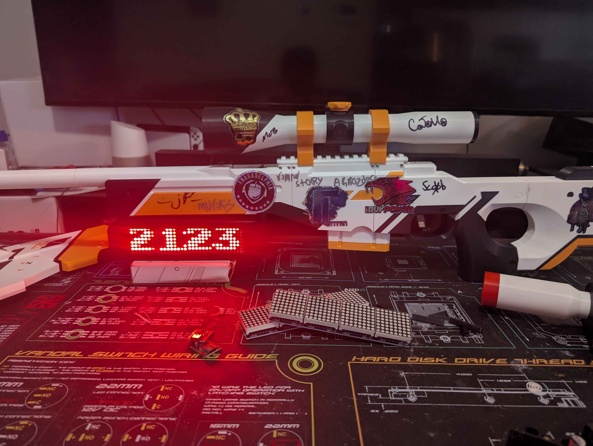

# StatTrak ESP32

[](https://github.com/BurneyProMod/stattrak-esp32/actions/workflows/ci.yml)


A statrak display that fetches player stats with the FaceIT and Leetify API

(Image Source: https://skinsmonkey.com/blog/best-csgo-stattrak-skins)

For now, the code only supports FaceIT ELO, but it will be expanded to additional stats such as Win/Loss, CS2 Premiere rank, league placement, and more.

## TODO

- Fix Font Scaling (Alternatively, look into different displays)
- Store local variables in SQLite
- Display Extended FaceIT stats
- Leetify API
- Twitch API
- Edit case .stl to fit under 3D Printed AWP Asiimov
- HTTP server that displays pull their stats from, instead of the laptop pushing to one display. Needed before selling: it keeps the FACEIT API key off the devices and lets one server feed many displays.

## Flashing ESP32
### Prereqs:
1) Install pipx
  `sudo apt install -y pipx`
2) Install ESPHome
`pipx install esphome`
### Flashing:
1) Copy `secrets.example.yaml` to `secrets.yaml` and fill in your Wi-Fi details and an OTA password.
2) Plug in the ESP32 over USB and run this in the repo directory:
`esphome run esp32.yaml`

After the first USB flash, `esphome run esp32.yaml` can update the firmware over Wi-Fi.

The display shows `----` until it receives an Elo.

## FACEIT API Documentation
- https://docs.faceit.com/api/data/

## Leetify API Documentation
- https://leetify.com/blog/leetify-api-developer-guidelines/
## Requirements

- Pipx
- ESP-Home
- Go 1.24+
- A FACEIT API key

## Setup
1) Edit the `.env.example` file in the project root:
```
FACEIT_API_KEY=your_key_here
FACEIT_NICKNAME=username_here
FACEIT_GAME=cs2
```
Then rename to `.env`

2) Run (dependencies are fetched automatically from `go.mod`):
```
go run ./cmd/stattrak
```
Optional flags: `-metric elo|matches|age|wl` (default `elo`), `-game cs2|csgo`.

Each lookup also saves the player's ID, nickname, and Steam ID to a local SQLite file, `stattrak.db`.

3) Keep the display updated (fetches the Elo and sends it to the display every minute):
```
go run ./cmd/stattrak -device http://faceit-clock.local
```
Use `-interval 5m` to change how often it updates (10s minimum). If `faceit-clock.local` doesn't resolve on your network, use the display's IP address instead (shown in the ESPHome logs).

## Running Tests
```
go test ./...
```
API tests run against a local fake FACEIT server using the sample responses in `api/testdata/`, so no API key is needed.

## Project Layout
```
api/            FACEIT Data API client
db/             SQLite storage for player info
display/        Sends the Elo to the LED display
cmd/stattrak/   Command-line entry point
esp32.yaml      ESPHome firmware for the LED matrix
```

## References:
1) https://www.xda-developers.com/built-15-esp32-smart-clock/
2) https://mholt.github.io/json-to-go/